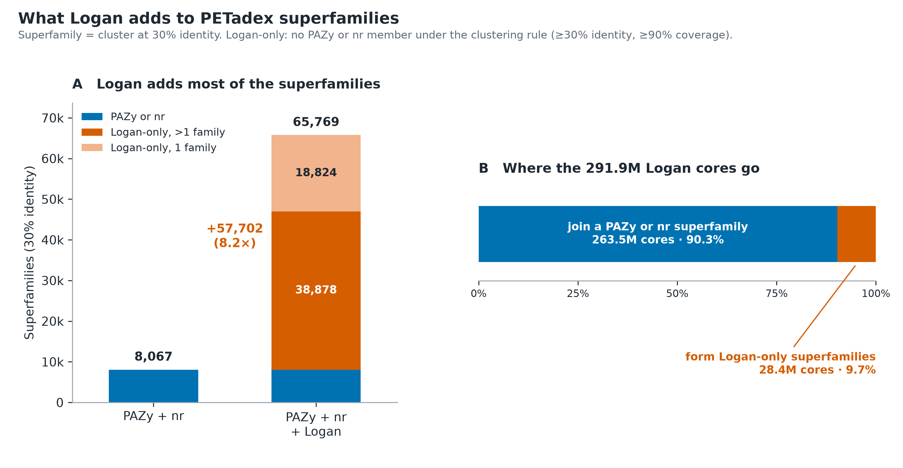

# PETadex catalytic-core clustering (v260701)

Every complete catalytic core in PETadex, 298.7 million of them, clustered into a 90 % → 60 % → 30 % identity hierarchy
within each of 15 CATH domains. The run used Benjamin Buchfink's `unid/` pipeline with DIAMOND 2.2.4 on `watson`, from
2026-10-24 to 2026-11-04. The 30 % clusters are called superfamilies.

**Start with the notebook: [`petadex_clustering_experiment.ipynb`](petadex_clustering_experiment.ipynb).** It covers the
input, method, validation, results and diagnostics, with all figures. [`docs/caveats.md`](docs/caveats.md) lists what to know
before quoting the numbers.

## Results

| Level | Clusters | From |
|---|---:|---|
| input | 298,687,346 cores | 486 PAZy · 6,764,617 nr · 291,922,243 Logan |
| 90 % | 32,022,716 | |
| 60 % | 3,230,662 | |
| 30 % (superfamilies) | 65,769 | |



- **Valid hierarchy.** Every core is in exactly one cluster at every level, no protein is the centroid of more than one cluster,
  and each level nests exactly in the one above (all 15 domains).
- **Logan adds most of the superfamilies.** PAZy + nr alone give 8,067 superfamilies; with Logan there are 65,769. The 57,702
  added superfamilies contain no PAZy or nr sequence under the clustering rule.
- **Most Logan sequences fill out known superfamilies.** 90.3 % of Logan cores join a superfamily that has a PAZy or nr member;
  9.7 % form the Logan-only ones.
- **The 76 superfamilies containing a PAZy enzyme** hold 15.8 % of all cores (6.6 % of the distinct 60 % families).
- **Singletons** are nearly all Logan-centred, hold almost none of the sequence, and are shorter than non-singletons. Logan cores
  are often fragments (median 213 aa against 293 aa for nr).
- **Compared with v1.1** (Benjamin's earlier run), v2 has 1.8–3.0× as many clusters. The runs are not like-for-like: v1.1
  clustered full ORFs from an older input (see the caveats).

## Layout

| Path | Content |
|---|---|
| `petadex_clustering_experiment.ipynb` | the narrative: input, method, validity, results, diagnostics |
| `docs/` | `caveats.md` (open issues, comparability), `unid_pipeline_upstream.md` (what each pipeline step does, Run 2 deviations), `run_history.md` (earlier runs) |
| `pipeline/` | the Run 2 pipeline code: vendored `unid/` scripts (upstream commit in `unid/UPSTREAM_COMMIT`), per-level configs, drivers (`run_unit.sh`, `run_chain.sh`), the DIAMOND wrapper, and `ops/` (guards, notifier, pause/stop/resume) |
| `analysis/` | statistics, diagnostics (`diagnose/`), the uniqueness/nesting check, figure builders (`build_*.py`), and `make_notebook.py` |
| `figures/` | final figures, PNG + SVG |

**Not in the repo** (on `watson`, under `/watson/rnalab/dzhu/petadex-clustering/`):
- `run2/`: the cluster files (`L90|L60|L30/<domain>.all.tsv`, `centroid<TAB>member`) and centroid FASTAs (`L*/reps/`), 268 GB.
  The pipeline ran from there; the copies in `pipeline/` keep their original absolute paths.
- `data/`: the tables the figures and notebook read, produced by `analysis/`.
- `archive/`: Run 1 and earlier work.

## Rebuilding the figures and notebook

Needs Python with pandas, matplotlib and nbformat (conda env `embsearch` on watson).

```bash
cd analysis
./extract_stats.sh                                   # run2/L*/ -> data/cluster_stats.tsv, counts
./count_method_flow.sh                               # rows assigned per mapping step
diagnose/diag_clusters.sh; diagnose/diag_lineage.sh  # per-cluster properties, cores beneath each cluster
diagnose/diag_fragmentation.sh; diagnose/diag_size_hist.sh
./uniqueness_check.sh                                # uniqueness and nesting, reports in data/uniqueness/
python build_diagnostic_figures.py                   # first: also writes tables used below
python build_figure1.py; python build_figureS1.py; python build_demo_figures.py
python build_method_figure.py; python build_size_figure.py; python build_fragmentation_figure.py
python make_notebook.py && jupyter nbconvert --to notebook --execute --inplace ../petadex_clustering_experiment.ipynb
```

The diagnostics read all 298.7 M rows of the 90 % cluster files and take a few minutes each.
